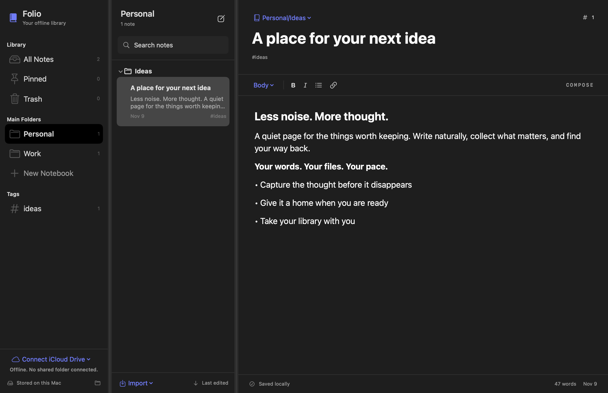

# Folio

**A quiet place for everything worth keeping.**

Native Mac writing. An offline iPad reader. Readable Markdown. MIT licensed.
Folio aims for Apple Notes' simplicity, Joplin's notebook management and
Obsidian's ownership and extensibility, without turning your notebook into
a dashboard.

This is an independent community project, not affiliated with those products.
Contributions are welcome: see [CONTRIBUTING.md](CONTRIBUTING.md) and the
[extension API](EXTENSIONS.md).



## What is actually ready

**0.4.1 is a development release, not a finished replacement for your library.**
The Mac app is packaged as a DMG. The native iPhone/iPad reader builds as a
device application but still requires your Apple signing and a real-device
check before installation. Its interface is read-only by design.

The iCloud Drive folder exchange is **experimental**. Its merge, conflict,
deletion and offline-resource behaviour is covered by local filesystem tests;
cross-device iCloud delivery has not been validated on physical devices.
Keep an independent backup and start with a small test notebook.

## Install on Mac

Download the Apple Silicon DMG from [GitHub Releases](https://github.com/stevey-m/folio/releases).
Open `Folio-0.4.1-arm64.dmg`, drag **Folio** to **Applications**, eject the
image and launch. If building locally, the DMG is in `dist/`.
Quit the old Folio before replacing it. Existing libraries
load without manual conversion. Export a complete backup before upgrading;
older releases cannot read the new native-composition format marker.

Requires macOS 14+. This DMG targets Apple Silicon; Intel requires a separate
build. Development bundles are ad-hoc signed, not Apple-notarized. For a build
you trust, macOS may require **System Settings > Privacy & Security > Open Anyway**.

## A notebook, not a control panel

- **Compose directly into the page.** New Mac notes use a native AppKit editor
  for headings, bold, italic, bullets, quotes, code, links and inline images.
  The saved body is ordinary Markdown, not RTF, base64 or an opaque editor model.
  Native undo/redo and spelling are available. Formatting shortcuts include
  Command-B and Command-I.
- **Keep advanced source intact.** Imported Markdown and HTML remain in their
  original source format with Write, Split and Preview modes. The bounded
  formatted editor is not a full Markdown round-trip editor. For tables,
  nested lists and other advanced structures, choose **Note actions > Use
  Markdown Source Editor** or **File > New Markdown Source Note**. Switching
  changes only the editing mode, not the body. Unsupported structures are
  rejected by the formatted editor rather than silently flattened.
- **Capture without organising.** Quick Capture is a separate floating window,
  available from the menu bar, toolbar or Command-Shift-Space while Folio is
  active. Save to Inbox with Command-Return. Unsubmitted drafts remain locally
  when the window closes; failed saves keep the draft. This is not a global
  keyboard hook.
- **Jump to a thought.** Command-K opens an all-library finder with
  keyboard selection, matching passages and a note preview. Search includes
  titles, text, tags and notebook names. The note-list search stays scoped to
  the current collection. Search works offline; OCR, attachment-text indexing
  and semantic/AI search are not implemented.
- **Use notebooks that behave like notebooks.** Nested paths form collapsible
  trees. Main folders stay on the left; their expandable subtopics and notes
  appear in the middle; selecting a note displays it on the right. Notes saved
  directly in a main folder remain visible above its subtopics. Search reveals
  matching notes inside subtopics. On Mac, use a folder's context menu to add a
  subtopic or create a note in it. Tags, pins, moving notes, Trash and restore are included. Navigation
  widths are saved and do not grow when selecting long names. Drag dividers,
  hide either pane or toggle focused writing to return the space to the page.
- **Connect ideas with plain text.** Write `[[Note title]]`, `[[Notebook/Note
  title]]` or `[[Note title|display label]]`. Preview links open notes on both
  Mac and iPad. **Note actions > Linked Mentions** shows backlinks on Mac.
  Duplicate titles need a qualified notebook path. Code examples are not
  treated as links. Renames do not automatically rewrite existing links.
- **Let pictures fill the page.** Images fill the available document width in
  Preview and Compose, even when the text uses a narrower reading column.
  Original files and aspect ratios are preserved. Click an image to open it
  in the main document area, not a popup or another application. Pinch on the
  trackpad to zoom, scroll to pan, and choose **Fit to window** to reset.
  **Back to note** (or Escape on Mac) returns without rebuilding the note view.
  The iPad reader uses the same in-document navigation with pinch and drag.
  Smaller preview sizes remain available in Settings.
  Add files with the paperclip, drag files into Compose,
  or paste files copied in Finder. Text paste is intentionally plain text;
  clipboard-only image paste and rich-text paste are not yet supported.
- **Make it yours, quietly.** System and Dracula appearances, font family, text
  size, image display size and full-width reading are in Settings. Tags are
  tucked behind the tag button rather than always exposing an editing field.

Notes save atomically to the local library. Save failures are visible; changes
stay in memory and Folio warns before quitting. History retains up to 20
title/body/format checkpoints, at most once per five minutes of editing.
Restoring also preserves the current version.

## Your Mac library on iPad

The first iPad experience is deliberately **viewing only**: notebooks, tags,
search, readable pages and tap-to-open original images in the document area. There are no
half-finished editing controls.

1. On Mac, create a dedicated folder in **iCloud Drive**. In Folio choose
   **File > Connect iCloud Drive Folder**, then **Sync Now**.
2. Let iCloud upload it. In Files on iPad, make the folder available offline
   using **Keep Downloaded** where available.
3. In the iPad reader, choose **Connect iCloud Drive Folder** and select that
   same folder. It downloads and verifies a local copy.
4. After making changes on Mac, choose **Sync Now**. On iPad, **Refresh from
   Mac** fetches them; the reader also refreshes on returning to the foreground.

Reading, search and images continue to work after disconnecting. A failed
refresh leaves the prior local cache intact and shows an explicit status.
Disconnecting a folder does not delete your local notes.

The working `library.json` is **never** shared. The folder contains immutable,
checksummed snapshots, version vectors and original resources. Concurrent
Mac edits are retained as deterministic conflict copies tagged `sync-conflict`.
Permanent deletions have tombstones so a stale device does not resurrect them.
The read-only iPad pulls snapshots without publishing changes.

This is snapshot exchange, **not continuous background sync**. iCloud may
deliver files at different times; incomplete or damaged snapshots fail
verification and need a later retry. Initialise the folder on one Mac and let
it download before connecting another device.

Snapshots currently contain full copies and are retained indefinitely. They
can use significant cloud/local space. Automatic compaction and garbage
collection are not implemented. Previously synced/deleted notes can remain in
old snapshots. This is not end-to-end encryption; protect the iCloud folder
and only share it with trusted people.

### Install on your iPad using Xcode

No paid Apple Developer membership is required for a personal Xcode install.

1. Open `FolioMobile.xcodeproj` in Xcode.
2. In **Xcode > Settings > Accounts**, sign in with your Apple ID.
3. Select the **FolioMobile** target, **Signing & Capabilities**, enable
   automatic signing and select your **Personal Team**.
4. Choose a unique bundle identifier such as `your.reverse.domain.folio`.
5. Connect and trust your iPad, enable Developer Mode if prompted, select it
   as the run destination and press **Run**.

Free provisioning expires and may require rebuilding/reinstalling. The DMG
does not install on iPad. An unsigned `.app` is not an installable iPad release.
No Apple credentials or signing team are stored in this repository.

For a reproducible **unsigned build**, not an installation:

```bash
bash scripts/build-ipad.sh
```

An iOS runtime must be installed separately to run Simulator. A successful
device build is not a substitute for testing the reader and iCloud transfer
on your iPad.

## Import your existing notes

**Joplin:** export **MD - Markdown + Front Matter**, then choose **File >
Import Joplin Folder**. Titles, tags, dates and notebook paths are preserved.
The export and its original resources are copied into Folio; the source export
can then be removed. Other YAML fields remain in the copied originals.
JEX, RAW exports and unexported `:/resource-id` links are not supported.

**Markdown/HTML:** import individual UTF-8 files or a whole export folder.
Directly linked images and files are copied. Links outside an individual
file's folder require importing the containing folder instead. Folder imports
retain shared resources and nested notebook paths. Invalid metadata, unreadable
resources and symbolic links fail before committing partial notes.

CommonMark/GFM preview includes tables, fenced code, lists, task markers,
quotes, links and sanitized HTML. HTML source is retained, but its original
stylesheets and active content are not reproduced. Remote images, scripts,
forms and embeds are blocked. Local images are restricted to the note's
resource root. Relative links to other documents open their saved originals,
not editable Folio notes.

Evernote ENEX, web clipping and OCR are not implemented.

## Open formats and backups

**File > Export Open Markdown Folder** creates ordinary Markdown/HTML files,
notebook folders, metadata and original linked attachments. Markdown has YAML
front matter; HTML has a metadata sidecar. Notes have separate resource trees
so relative links keep working, which can duplicate shared attachments.
This is a portable snapshot you can open with other tools, not a live Obsidian
vault backend.

**File > Export Complete Backup** includes the full library, history and copied
original resource trees. **Import Folio Backup** adds records without replacing
existing notes. Backups use portable relative paths and can be moved between
devices. Device-local sync state and folder permissions are not exported.

The Mac working library is:

```text
~/Library/Application Support/Folio/
  library.json
  Imports/
  Attachments/
  SyncAssets/
  Extensions/
  sync-folder.bookmark
```

Keep it in Time Machine or export backups. Do not put the live `library.json`
in a shared folder or run separate app processes against it. Individual-note
export writes only the source body; use an open-folder export or complete
backup for original attachments.

There is no Folio account, subscription, analytics service or runtime server.
Your chosen system iCloud account handles file delivery. Local notes, drafts
and snapshots are not encrypted by Folio. Use device protection/FileVault.
History and retained attachments are not substitutes for independent backups.

## Build and contribute

In the original parent repository, first `cd MacNotes`. In the standalone
source archive or repository, start at its root:

```bash
bash scripts/test.sh
bash scripts/build-app.sh
open dist/Folio.app
bash scripts/build-dmg.sh
bash scripts/build-ipad.sh
bash scripts/package-source.sh
```

Requires Swift 6, macOS 14+ and Xcode for the iOS build. Dependencies are pinned
in `Package.resolved`. Initial development builds fetch them. Tests cover
storage, imports, sanitization, real WebKit images, native formatting/undo,
pane measurements, capture, search, open export, extensions and sync merges.
The presentation test generates `dist/Folio-compose-preview.png` from
synthetic notes, never the user's library.

`Sources/NotesCore` holds portable models, rendering, imports, extension
validation and folder exchange. `Sources/Folio` is the native Mac interface
and shared store. `Mobile` is the native iPad/iPhone reader. WebKit is an
embedded document preview, not a web-app shell.

The standalone source archive includes MIT licensing, contributor guidance,
an example extension and macOS CI. The nested `.github/workflows` becomes
active when Folio is published at its own repository root; it does not
replace the original parent repository's workflows.

## License

[MIT](LICENSE). Third-party dependencies retain their respective licenses;
the packaged Mac app includes their notices.
